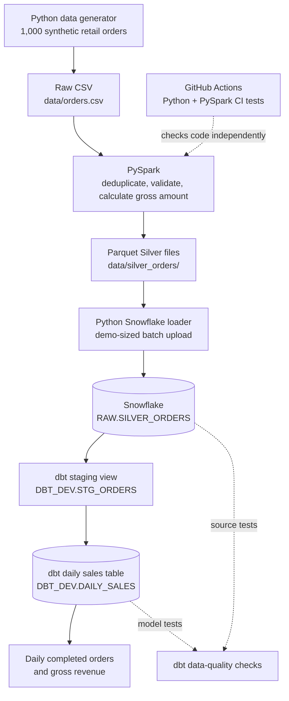

# Retail Data Engineering Pipeline

[](https://github.com/bharadwajchinthala/enterprise-data-engineering-pipeline/actions/workflows/ci.yml)

**Python · PySpark · Parquet · Snowflake · dbt Core · SQL · pytest · GitHub Actions**

A reproducible **batch data engineering portfolio project** that converts synthetic retail transactions into tested daily sales analytics. It demonstrates the movement from raw CSV data through a PySpark Silver layer into Snowflake, followed by dbt SQL modeling and data-quality checks.

> **Project v1.0 — Complete.** Validated locally on a sample of 1,000 synthetic orders. The independent Python/PySpark GitHub Actions workflow also passed. All data is synthetic; this project does not use real customer or employer data.

## Architecture



**Data flow:** The actual dbt analytics source is **Snowflake `RAW.SILVER_ORDERS`**, populated from PySpark's cleaned Parquet output. The optional CSV loader into `RAW.RAW_ORDERS` is not part of the analytics path.

## Sample results

Verified against the Snowflake models after a successful local pipeline execution:

| Measure | Result |
| :-- | --: |
| Synthetic orders generated / Silver rows | **1,000** |
| dbt staging rows | **1,000** |
| Completed orders | **566** |
| Completed gross revenue | **$412,491.12** |
| dbt execution | **2 models built; 6 data tests passed** |
| Full local pipeline | **5 of 5 stages passed in 25.1 seconds** |
| GitHub Actions | **Python/PySpark CI passed** (first run: 43 seconds) |

*Illustrative sales figures come from deterministic synthetic data. Runtime is an observed result, not a performance guarantee or production benchmark.*

The daily sales mart calculates completed-order count and revenue **by order date**. Cancelled and returned orders are excluded from completed sales revenue.

## What this demonstrates

- **Ingestion:** Generate reproducible CSV transactions with Python.
- **Transformation:** Use PySpark for duplicate removal, invalid-row filtering, and gross amount calculation.
- **Storage:** Write cleaned orders as Parquet and load them into an isolated Snowflake Silver table.
- **Analytics modeling:** Use dbt to build a staging view and a daily sales table.
- **Quality:** Apply Python/PySpark tests and six Snowflake/dbt data tests.
- **Automation:** Execute five dependent stages from one local command, failing immediately if a stage fails.
- **CI:** Run Python and PySpark tests on GitHub Actions for pushes and pull requests without exposing Snowflake credentials.

## Repository guide

| Path | Purpose |
| :-- | :-- |
| `src/generate_data.py` | Reproducible retail transaction generation |
| `src/transform_orders.py` | PySpark cleaning and Parquet creation |
| `src/load_silver_snowflake.py` | Small-scale Snowflake Silver ingestion |
| `src/run_pipeline.py` | Local pipeline runner |
| `dbt/models/staging/` | Source declarations and cleaned staging view |
| `dbt/models/marts/` | Daily completed-order sales mart and tests |
| `tests/` | Python and PySpark tests |
| `.github/workflows/ci.yml` | CI workflow; no live Snowflake credentials |

## Run locally

**Prerequisites:** Python 3.11, Java 17, a Snowflake account with an appropriately sized warehouse and permissions to use the project schemas, and Git.

1. Clone the repository and set up a virtual environment:

```bash
git clone https://github.com/bharadwajchinthala/enterprise-data-engineering-pipeline.git
cd enterprise-data-engineering-pipeline
python3.11 -m venv .venv
source .venv/bin/activate
python -m pip install -r requirements.txt
```

2. Initialize the Snowflake database/schema using [`sql/setup.sql`](sql/setup.sql). Configure `~/.dbt/profiles.yml` with a profile named `retail_analytics`, your Snowflake connection, database `RETAIL_PORTFOLIO`, and dbt output schema `DBT_DEV`.

3. Copy [`.env.example`](.env.example) to a local `.env` and enter your **own** Snowflake settings. Keep `.env` private. For supported browser sign-in, set `SNOWFLAKE_AUTHENTICATOR=OAUTH_AUTHORIZATION_CODE`.

4. Run the entire pipeline:

```bash
set -a
source .env
set +a
python -m src.run_pipeline
```

The runner generates 1,000 records by default, runs a generator unit test, transforms orders with PySpark, loads the Snowflake Silver table, and runs `dbt build`. You may be prompted to authenticate with Snowflake through your browser.

5. Inspect the results in Snowflake:

```sql
SELECT COUNT(*) AS SILVER_ORDERS
FROM RETAIL_PORTFOLIO.RAW.SILVER_ORDERS;

SELECT COUNT(*) AS STAGING_ORDERS
FROM RETAIL_PORTFOLIO.DBT_DEV.STG_ORDERS;

SELECT SUM(COMPLETED_ORDER_COUNT) AS COMPLETED_ORDERS,
       SUM(GROSS_REVENUE) AS COMPLETED_REVENUE
FROM RETAIL_PORTFOLIO.DBT_DEV.DAILY_SALES;
```

**Run tests without Snowflake:**

```bash
python -m pytest -v tests/
```

The [GitHub Actions runs](https://github.com/bharadwajchinthala/enterprise-data-engineering-pipeline/actions) show the separate Python/PySpark CI checks.

## Design choices and limitations

This is an intentionally small, **local batch demonstration**, not a deployed production platform:

- The Silver loader collects a maximum of 10,000 rows locally and reloads the dedicated `RETAIL_PORTFOLIO.RAW.SILVER_ORDERS` table. Large datasets should use staged bulk loading (`COPY INTO`), incremental ingestion, and transactional safeguards.
- The pipeline runner is a command-line orchestrator, not a cloud scheduler, Airflow DAG, or unattended production service.
- GitHub Actions validates Python/PySpark tests and repository files; **it does not connect to Snowflake or execute dbt against a live warehouse**.
- The generated sample data contains valid orders; filtering logic is exercised separately by automated tests.
- Next-generation features such as incremental `MERGE`, monitoring, alerting, and cloud scheduling are **future enhancements**, outside the completed v1.0 scope.

## Security

All example data is synthetic. Local credentials, environment files and generated records are excluded from Git. Never commit tokens, passwords, private Snowflake configuration or real customer records.

---

**Portfolio summary:** Built a reproducible Python/PySpark → Parquet → Snowflake → dbt retail analytics pipeline with six dbt quality tests, a one-command local runner, and independent GitHub Actions Python/PySpark CI. Verified 1,000 sample orders and a completed-sales mart using synthetic data.
